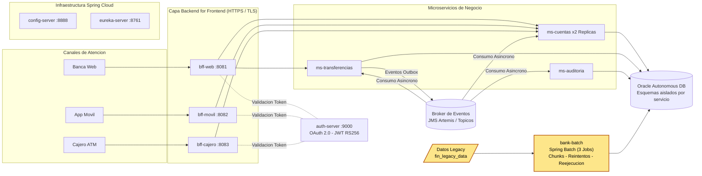

# Modernizacion de Core Bancario: Spring Cloud y Batch

**Desarrollo Backend III - EFT**

Solucion integral de modernizacion para el Banco XYZ, transitando desde un sistema monolitico legacy (COBOL y scripts Shell en mainframe) hacia una arquitectura distribuida cloud-native basada en microservicios, capas BFF especializadas y procesamiento masivo resiliente.

---

* **Codigo fuente:** [Repositorio GitHub](https://github.com/SebastianGIS/backend_III_EFT)

## 1. Documentos de la Entrega

| Archivo / Carpeta | Descripcion del Contenido |
|---|---|
| `readme.md` | Vision general del proyecto, mapa arquitectonico, cumplimiento de pauta y estructura del repositorio. |
| `instrucciones.md` | Guia tecnica paso a paso para compilar, ejecutar y verificar cada componente en entorno local. |
| `despliegue.md` | Procedimiento detallado de despliegue en la nube (AWS EC2) y conexion con Oracle Autonomous Database. |
| `Informe_Tecnico_EFT.pdf` | Informe formal de ingenieria (plantilla Duoc UC) con justificacion de negocio, arquitectura y diagramas. |
| `evidencias/` | Registros de ejecucion: `01` a `05` (procesos batch en local); `10` a `12` (despliegue productivo en AWS EC2 con Oracle ADB). |
| `video_presentacion.mp4` | Exposicion de 5 a 7 minutos cubriendo resumen ejecutivo, resultados, desafios y mejoras. |

---

## 2. Diagrama de Arquitectura de la Solucion



---

## 3. Matriz de Cumplimiento de Requerimientos Tecnicos

| Dimension | Requerimiento de la Evaluacion | Implementacion en el Repositorio | Evidencia Validada |
|---|---|---|---|
| **Parte 1: Batch** | Reescritura de 3 procesos legacy en Spring Batch (lectura, proceso, escritura) | Modulo `bank-batch`: `transaccionesJob`, `interesesJob`, `anualesJob`. | `evidencias/01_batch_transacciones.txt` a `03_batch_anuales.txt` |
| **Parte 1: Batch** | Manejo avanzado de errores, reintentos y tolerancia a fallos transitorios | Politicas de retry con backoff exponencial, skip de filas corruptas con registro de auditoria. | `evidencias/01` a `03` |
| **Parte 1: Batch** | Optimizacion de alto volumen y rendimiento | Estrategias multihilo y particionado concurrente configurable (`bank.escalado.modo`). | `instrucciones.md` 1 |
| **Parte 1: Batch** | Politicas de finalizacion y reejecucion automatica ante fallos criticos | Componentes `CalidadDatosDecider`, `VerificarConexionConfig` y `ReejecucionAutomatica`. | `evidencias/04_falla_tecnica.txt` y `05_error_datos.txt` |
| **Parte 2: BFF** | Implementacion de BFF diferenciado para Web, Movil y Cajeros Automaticos | Modulos independientes `bff-web`, `bff-movil` y `bff-cajero` con payloads optimizados por canal. | `evidencias/10_nube_ec2_oracle.txt` 2 |
| **Parte 2: BFF** | Seguridad por canal, HTTPS y gestion de tokens | Validacion de audiencia (`aud`), claims contextuales, credenciales de terminal/PIN y cifrado TLS. | `evidencias/10_nube_ec2_oracle.txt` 1 y 2 |
| **Parte 3: Microservicios** | Modularizacion en servicios clave con aislamiento de datos | Modulos `ms-cuentas`, `ms-transferencias` y `ms-auditoria` con esquemas independientes en Oracle ADB. | `evidencias/10_nube_ec2_oracle.txt` |
| **Parte 3: Cloud** | Configuracion centralizada y descubrimiento dinamico | Servicios `config-server` y `eureka-server` con resolucion de balanceo `lb://`. | `evidencias/11_nube_eureka.png` |
| **Parte 3: Seguridad** | Seguridad distribuida con Spring Security y OAuth 2.0 | Modulo `auth-server` con Spring Authorization Server emitiendo JWT con firma asimetrica RS256. | `evidencias/10_nube_ec2_oracle.txt` 1 |
| **Parte 3: Resiliencia** | Tolerancia a fallos y degradacion elegante con Resilience4j | Configuracion de Circuit Breaker, Retry, Bulkhead y Fallbacks ante caida de servicios. | `evidencias/10_nube_ec2_oracle.txt` 3 a 7 |
| **Parte 3: Eventos** | Comunicacion asincrona mediante topicos, productores y consumidores | Orquestacion de transferencias mediante Patron Saga coreografiado, Outbox y Dead Letter Queues (DLQ). | `evidencias/12_nube_broker_topologia.png` |
| **Despliegue** | Contenedorizacion con Docker Compose y despliegue en AWS | Dockerfile multi-etapa optimizado, `docker-compose.yaml` (12 servicios) desplegados en AWS EC2. | `despliegue.md`, `evidencias/10_nube` 0 |

---

## 4. Estado de Alcance y Hoja de Ruta (Roadmap)

Con el fin de garantizar estabilidad operativa completa y verificacion en nube, se adoptaron decisiones de diseno especificas, planificando su evolucion en las siguientes etapas:

| Requerimiento Teorico | Implementacion Actual | Justificacion Tecnica y Siguiente Paso |
|---|---|---|
| **Broker Apache Kafka** | Broker JMS / ActiveMQ Artemis con topicos y DLQ | Cumple formalmente con el desacoplamiento asincrono, productores, consumidores y semantica de topicos para la Saga. La logica de dominio esta aislada en `bank-eventos`, lo que permite migrar el transporte a Kafka KRaft sin alterar el codigo de negocio. |
| **Servicio de Clientes** | Datos del titular gestionados dentro de `ms-cuentas` | Priorizo la consistencia de datos de las cuentas migradas del dataset legacy. Siguiente paso: segregar la entidad en un microservicio autonomo `ms-clientes` con base de datos propia. |
| **Operaciones de Deposito y Pago** | Transferencias completas (Saga) y retiros en cajero | Implementa el flujo critico mas complejo. Siguiente paso: extender los eventos de la Saga para abarcar pagos de servicios y depositos en efectivo. |
| **Gateway Perimetral** | Balanceo y resolucion cliente via Spring Cloud LoadBalancer (`lb://`) | La resolucion dinamica se realiza directamente sobre Eureka. Siguiente paso: desplegar Spring Cloud Gateway como proxy perimetral unificado frente a los BFFs. |
| **Escalado Horizontal** | Replicas activas probadas en `ms-cuentas` (`deploy.replicas: 2`) | Se valido el balanceo dinamico y tolerancia a la caida de una instancia. Siguiente paso: habilitar escalado multirreplica en `ms-transferencias` y `ms-auditoria`. |

---

## 5. Estructura del Proyecto

```text
bank-cloud/
├── Dockerfile                   # Compilacion multi-etapa y empaquetado optimizado
├── docker-compose.yaml          # Orquestacion de infraestructura, limites de recursos y redes
├── .env.example                 # Plantilla de variables de entorno y credenciales seguras
├── evidencia_nube.ps1           # Script automatizado para captura de evidencias en AWS
├── bank-batch/                  # PARTE 1: Implementacion de Spring Batch
│   └── src/main/java/cl/duoc/bank/batch/
│       ├── transacciones/       # Job 1: Deteccion de anomalias y resumen diario
│       ├── intereses/           # Job 2: Liquidacion periodica de ahorro y prestamos
│       ├── anuales/             # Job 3: Consolidacion anual para auditoria
│       └── common/              # Politicas de retry, skip, particionado y reejecucion
├── bff-web/                     # PARTE 2: BFF optimizado para navegadores y datos complejos
├── bff-movil/                   # PARTE 2: BFF optimizado para ancho de banda reducido
├── bff-cajero/                  # PARTE 2: BFF enfocado en operaciones criticas y cajeros ATM
├── auth-server/                 # Servidor de Autorizacion OAuth 2.0 (Spring Authorization Server)
├── config-server/               # Repositorio y servidor de configuracion centralizada
├── eureka-server/               # Registro y descubrimiento dinamico de microservicios
├── broker-mensajeria/           # Broker de mensajeria con soporte de topicos desacoplados
├── ms-cuentas/                  # Microservicio de cuentas, saldos, retiros y particion en Saga
├── ms-transferencias/           # Microservicio orquestador de transferencias y patron Outbox
├── ms-auditoria/                # Microservicio de registro inmutable de eventos operacionales
├── bank-core/                   # Librerias compartidas (contratos, seguridad, eventos y utilidades)
└── herramientas/                # Scripts DDL para Oracle Autonomous DB y utilidades de carga
```

---

## 6. Conjunto de Datos y Persistencia

* **Datos Batch:** Procesados a partir del repositorio oficial legacy (`https://github.com/KariVillagran/fin_legacy_data`), subdirectorio `data/semana_3`.
* **Datos Transaccionales:** La ejecucion inicial del proceso batch inicializa la informacion en Oracle Autonomous Database (50 cuentas bancarias, 401 transacciones y 862 movimientos historicos), segmentando los registros por esquemas independientes para garantizar el aislamiento transaccional por servicio.